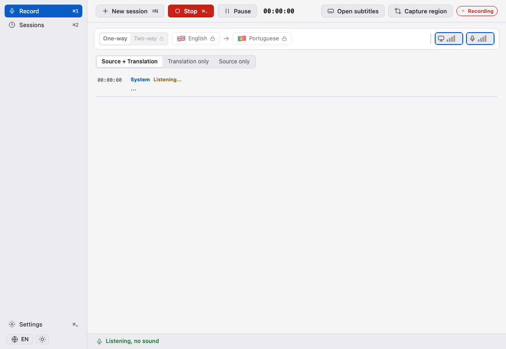
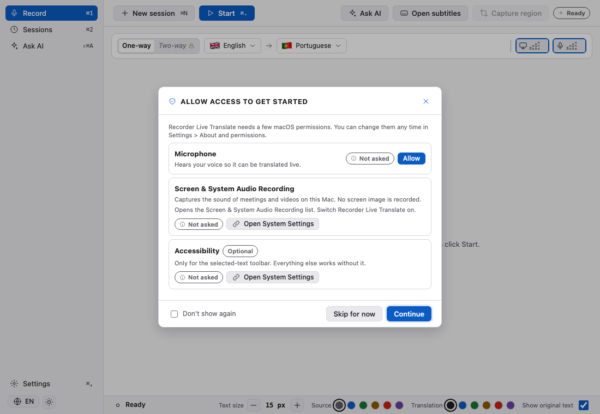

# Recorder Live Translate

Live speech transcription and translation for meetings and videos, on your Mac or Windows PC.

[English](README.md) | [Tiếng Việt](README.vi.md)

[](https://github.com/manhhope/recorder-live-translate-v3/actions/workflows/ci.yml)
[](https://github.com/manhhope/recorder-live-translate-releases/releases/latest)

[](LICENSE)



## Main features

Everything below exists in the code today. Items marked "optional" need a key or a sign-in from you.

- **Live transcription and translation** of your microphone and of the system audio (meetings, videos), through Soniox. Default pair: English to Portuguese (Portugal). The picker offers 13 languages (English, Japanese, Korean, Chinese, Vietnamese, Arabic, Portuguese, German, Hindi, Indonesian, French, Spanish, Thai) plus Auto-detect. One-way mode only; Two-way is shown in the UI but locked.
- **Live subtitles window**: a floating window with source text, translation, or both; font size, colours, background transparency, and an option to hide it from screen sharing (best effort).
- **Sessions**: every recording is saved on your computer, can be searched, renamed, and reopened as a transcript.
- **Capture region**: drag over any part of the screen; the app recognises the text (OCR), translates it, and can save the image into the session or send it to the AI assistant.
- **Quick Translate**: a small window for typed or pasted text (up to 5,000 characters) with a 50-item, 30-day history.
- **Translate selected text in place**: select text in any app, press a shortcut, and the translation replaces it (or is copied if pasting is not possible). An optional toolbar for selected text needs the macOS Accessibility permission.
- **Ask AI** about a transcript with your own key: Google Gemini, OpenAI, Ollama (on your computer), or any OpenAI-compatible server such as LM Studio.
- **Glossary** of custom terms; add a term from selected text.
- **Export** a session as Markdown, plain text, SRT subtitles, or Word (.docx): source and translation, translation only, or source only.
- **Optional engines and sync**: DeepL for typed text, selected text and OCR; Google Drive sync of transcripts (uses your own Google OAuth Client ID unless the build ships one).
- **Soniox usage logs** with weekly totals, and an estimated cost ceiling that only warns, never blocks.
- **Automatic updates** from signed GitHub Releases.
- **Interface languages**: English and Português (Portugal).

## Install

Download the installer for your system from the public releases page:
<https://github.com/manhhope/recorder-live-translate-releases/releases/latest>

| System | File |
| --- | --- |
| macOS, Apple Silicon | `RLT-darwin-aarch64.dmg` |
| macOS, Intel | `RLT-darwin-x86_64.dmg` |
| Windows, 64-bit | `RLT-windows-x86_64-setup.exe` |

**macOS.** Open the `.dmg` and drag the app to Applications. The app is signed with a local certificate (or ad-hoc), not with an Apple Developer ID, and it is not notarised, so Gatekeeper shows a warning the first time. Control-click (right-click) the app, choose **Open**, then **Open** again. If macOS still refuses, open System Settings > Privacy & Security and choose **Open Anyway** for this app.

**Windows.** Run the `setup.exe`. The installer has no Authenticode code-signing certificate, so SmartScreen may show "Windows protected your PC". Choose **More info**, then **Run anyway**. The installer installs for the current user only.

Updates are verified separately: the app only installs an update whose signature matches the public key built into it.

## System requirements

- **macOS 13 or later**, Apple Silicon or Intel.
- **Windows**: 64-bit. Windows 11 is the target of the project's CI notes; Windows 10 has not been verified. System audio uses the WASAPI process-loopback API.
- A **Soniox API key** and an internet connection for live transcription and translation.
- A microphone for your own voice. System audio needs no extra hardware.

## Quick start

1. Install and open the app. On macOS, grant the permissions in the welcome dialog (step 1 of the guide below).
2. Open **Settings > Soniox and Usage Logs**, paste your Soniox key, click **Save key**, then **Test connection**.
3. Check the languages in the bar (default English to Portuguese) and that at least one audio source is on.
4. Click **Start**. Read the consent message and accept it. Speech appears with its translation.
5. Click **Stop** to save the session.

## User guide

### 1. Grant permissions



macOS (the welcome dialog opens on first launch; you can reopen the permission list from Settings > About and permissions):

- **Microphone**: click **Allow** and accept the system prompt.
- **Screen & System Audio Recording**: click **Open System Settings** and switch Recorder Live Translate on. This is how system audio is captured; the app does not record a screen video. It is also needed for Capture region. macOS may ask you to restart the app afterwards.
- **Accessibility** (optional): only for the toolbar shown when you select text in another app.

Windows: there is no welcome dialog. System audio is captured with WASAPI process loopback, and the app excludes its own sound. For the microphone, make sure Settings > Privacy & security > Microphone allows desktop apps.

### 2. Enter your Soniox key

1. Create an account and an API key at <https://soniox.com> (Soniox is a third-party service with its own pricing).
2. In the app, open **Settings > Soniox and Usage Logs** and paste the key. You can also paste it in the prompt that appears when you press Start without a key.
3. Click **Save key**, then **Test connection**.

The key is stored in the macOS Keychain or the Windows Credential Manager (service `com.recorder.livetranslate.v3`). It is not written to the app database or logs, it is not shown again after saving, and it is sent only to Soniox. **Remove key** deletes it.

### 3. Choose the languages

In the bar above the transcript, pick the source language and the target language. The default is English to Portuguese (Portugal). The picker has a search box and a list of popular languages. The choice is locked while recording; stop the session to change it.

### 4. Start and stop recording

- Turn the **System** and **Microphone** source buttons on or off. The bars show the signal level.
- Click **Start**. The first time, a consent message reminds you that audio is sent to Soniox and that others in the meeting should be told.
- **Pause** and resume as needed; **Stop** ends and saves the session. If you quit during a recording, the app asks first and saves what it has.
- **New session** starts a fresh one.
- The view switcher shows source and translation, translation only, or source only.

### 5. Live subtitles

Click **Open subtitles** (also in the menu-bar or system-tray menu). The floating window can show both languages, source only, or translation only. Use the A- and A+ buttons for text size, and the settings menu for colours, background transparency, resetting the position, and hiding the window from screen sharing.


### 6. Capture region and OCR translation

Press the Capture region shortcut or click **Capture region** (also in the tray menu), then drag over an area (at least 50 x 50 px; Esc cancels). The app reads the text, shows it so you can edit it, and shows the translation. You can save the image into the current session (up to 200 images per session) or send it to the AI assistant. On macOS this needs the Screen & System Audio Recording permission. The OCR translation engine is chosen in **Settings > Translation and AI**.

### 7. Ask AI

Open **Ask AI** (sidebar or shortcut) and ask about a transcript; chips offer Explain, Summarise and Action items. Set it up in **Settings > Translation and AI**:

- **Google Gemini** or **OpenAI**: paste your own API key.
- **Ollama**: run Ollama on your computer; nothing leaves it.
- **OpenAI-compatible endpoint** (for example LM Studio): enter the base URL including `/v1`, such as `http://localhost:1234/v1`, and an optional key. An address outside your computer asks you to agree first.

The first time you use a provider, the app asks for consent. Until you agree, nothing is sent.

### 8. Export and copy

Open a session in **Sessions** and click **Export**. Choose the format (Markdown, text, SRT, Word), the content (source and translation, translation only, source only) and the folder. Text can also be copied from Quick Translate.

### 9. Keyboard shortcuts

These are global shortcuts, registered with the system. Change, reset or switch each one off in **Settings > Shortcuts**. A shortcut needs at least one of Cmd/Ctrl or Option/Alt (Shift alone is not enough).

| Action | macOS | Windows |
| --- | --- | --- |
| Quick Translate | Cmd+Shift+T | Ctrl+Shift+T |
| Translate selected text in place | Cmd+Shift+I | Ctrl+Shift+I |
| Ask AI | Cmd+Shift+A | Ctrl+Shift+A |
| Capture region | Cmd+Shift+S | Ctrl+Shift+S |

Inside Quick Translate: Cmd/Ctrl+Enter translates, Esc closes.

### 10. Automatic updates

Open **Settings > About and permissions**. Turn on **Update automatically**, or click **Check now** and then **Download and install**. An update never interrupts a recording in progress and is refused while recording. Updates come from the `latest.json` of the public releases repository and are installed only if their signature is valid.

### 11. Troubleshooting

- **The microphone is silent (x mark on the meter).** On macOS, allow Microphone in System Settings > Privacy & Security, then restart the app. On Windows, allow desktop apps in Privacy & security > Microphone. Check that the right input device is the system default and is plugged in.
- **No subtitles or no translation.** Turn on at least one audio source. Read the status bar: "Missing permission", "Quota exhausted", "Offline" and "Invalid key" each mean what they say. If Soniox quota is used up, translation stops but the audio is still recorded on your computer. Check that the other app is playing sound through the default output.
- **Key errors.** "Invalid key" or "Soniox rejected the request": paste the key again and click **Test connection**. For AI providers, "The key was rejected" means the key for that provider is wrong.
- **macOS asks for Keychain access again and again.** The app is not signed with a stable identity, so macOS may ask again after each update or new build. Choose **Always Allow** in the dialog. Inside a running app the key is cached to limit the prompts.
- **"The update failed its signature check and was NOT installed."** The download did not match the signed release. Try again later; if it persists, install the latest build by hand from the Releases page.
- **Capture region says Screen Recording permission is missing.** Allow it in System Settings, then try again.

## Privacy

- **Audio and transcripts.** While recording, audio is streamed to **Soniox** (`wss://stt-rt.soniox.com`) for transcription and translation. Sessions, glossary, history and settings are stored on your computer in the app data folder.
- **API keys.** Stored only in the operating system key store. Each key is sent only to the provider it belongs to.
- **Ask AI.** The transcript (and an attached image, if any) goes to the provider you chose: Gemini, OpenAI, your own OpenAI-compatible endpoint, or Ollama on your computer. Consent is asked first.
- **Optional services.** DeepL (only if you add a key), Google Drive (only if you connect it; the app can reach only files it created), and GitHub Releases for update checks.
- **No telemetry.** A search of the source finds no analytics or crash-reporting service. Crash details go to a local `crash.log` only. The evidence is in [docs/readme-bao-cao.md](docs/readme-bao-cao.md).

## For developers

### Architecture

- `crates/rlt-core`: pure Rust core; no Tauri and no OS API imports (ADR-1).
- `crates/rlt-platform`: OS adapters behind rlt-core traits (microphone, ScreenCaptureKit on macOS, WASAPI on Windows, Keychain and Credential Manager, native windows).
- `crates/rlt-soniox`, `rlt-ai`, `rlt-quick`, `rlt-features`, `rlt-store`, `rlt-secrets`, `rlt-segment`: Soniox client, AI providers, quick translate and DeepL, export and Drive, SQLite store, key store, paragraph splitting.
- `src-tauri`: the Tauri 2 app (commands, windows, tray, shortcuts, updater).
- `src`: the Svelte 5 + Vite frontend (`screens`, `ai`, `quick`, `subtitle`, `capture`, `i18n`, and `locales/en.json` and `pt-PT.json`).

### Build and test

```bash
npm install
npm run build            # frontend (Vite)
cargo build --workspace
cargo test --workspace
cargo clippy --workspace --all-targets -- -D warnings
npm run test:i18n && npm run test:unit
npx playwright test      # browser tests
cargo tauri dev          # run the app
```

CI (`.github/workflows/ci.yml`) runs these checks on macOS and Windows.

### Release

Follow [docs/phat-hanh.md](docs/phat-hanh.md): the developer opens a PR named `release X.Y.Z`; merging it tags the version, and the release workflow builds, signs and publishes to the public releases repository.

### Layout of `docs/`

- `docs/*-bao-cao.md`: report for each milestone or fix (Vietnamese).
- `docs/*-thiet-ke.md` and `docs/*-mockup.html`: design notes and mockups.
- `docs/phat-hanh.md`: release process. `docs/schema-v3.sql`: database schema.
- `docs/anh`, `docs/img`, `docs/img-onboarding-quyen`, `docs/img-usage-gon`: screenshots.

## License

MIT, see [LICENSE](LICENSE).
