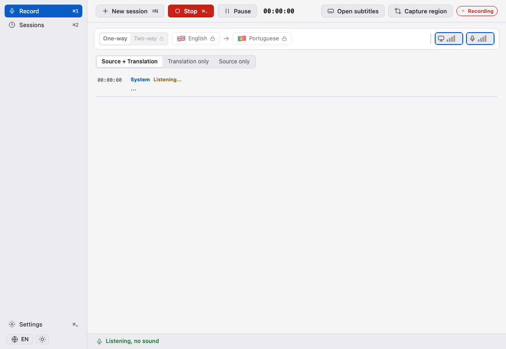
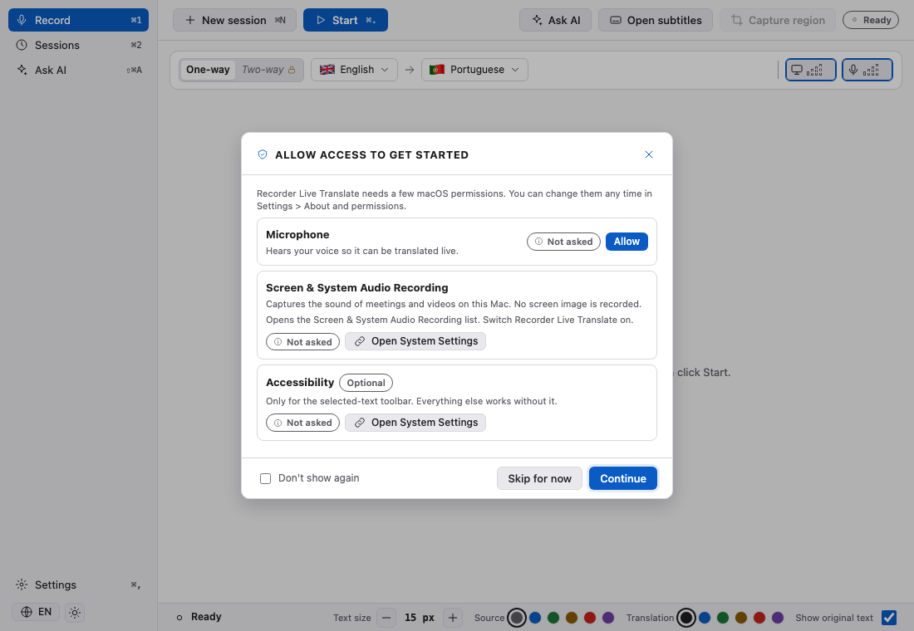

# Recorder Live Translate

Chép lời và dịch trực tiếp giọng nói trong cuộc họp và video, trên máy Mac hoặc Windows của bạn.

[English](README.md) | [Tiếng Việt](README.vi.md)

[](https://github.com/manhhope/recorder-live-translate-v3/actions/workflows/ci.yml)
[](https://github.com/manhhope/recorder-live-translate-releases/releases/latest)

[](LICENSE)



## Tính năng chính

Mọi mục dưới đây đều có trong code hiện tại. Mục ghi "tùy chọn" cần khóa hoặc đăng nhập của bạn.

- **Chép lời và dịch trực tiếp** từ micro và âm thanh hệ thống (họp, video) qua Soniox. Cặp mặc định: tiếng Anh sang tiếng Bồ Đào Nha (Bồ Đào Nha). Bộ chọn có 13 ngôn ngữ (Anh, Nhật, Hàn, Trung, Việt, Ả Rập, Bồ Đào Nha, Đức, Hindi, Indonesia, Pháp, Tây Ban Nha, Thái) và mục Tự nhận diện. Chỉ có chế độ một chiều; chế độ hai chiều hiện trên giao diện nhưng đang khóa.
- **Cửa sổ phụ đề nổi**: hiện bản gốc, bản dịch hoặc cả hai; chỉnh cỡ chữ, màu chữ, độ trong suốt nền, và có tùy chọn ẩn khỏi màn hình chia sẻ (cố gắng hết mức).
- **Phiên ghi**: mỗi lần ghi được lưu trên máy bạn, tìm kiếm, đổi tên và mở lại như một bản chép lời.
- **Chụp vùng**: kéo chọn một vùng màn hình; app nhận dạng chữ (OCR), dịch, và có thể lưu ảnh vào phiên hoặc gửi cho trợ lý AI.
- **Dịch nhanh**: cửa sổ nhỏ cho chữ gõ hoặc dán (tối đa 5.000 ký tự), có lịch sử 50 mục trong 30 ngày.
- **Dịch chữ đang bôi chọn tại chỗ**: bôi chọn chữ ở app bất kỳ, bấm phím tắt, bản dịch thay vào chỗ đó (hoặc được chép vào bộ nhớ tạm nếu không dán được). Thanh công cụ tùy chọn khi bôi chọn chữ cần quyền Trợ năng của macOS.
- **Hỏi AI** về bản chép lời bằng khóa của chính bạn: Google Gemini, OpenAI, Ollama (chạy trên máy bạn) hoặc máy chủ tương thích OpenAI như LM Studio.
- **Bảng thuật ngữ** riêng; thêm thuật ngữ từ chữ đang bôi chọn.
- **Xuất** phiên ra Markdown, văn bản thuần, phụ đề SRT hoặc Word (.docx): gốc kèm bản dịch, chỉ bản dịch hoặc chỉ bản gốc.
- **Công cụ và đồng bộ tùy chọn**: DeepL cho chữ gõ, chữ bôi chọn và OCR; đồng bộ bản chép lời lên Google Drive (dùng Client ID OAuth Google của bạn nếu bản cài không kèm sẵn).
- **Nhật ký dùng Soniox** theo tuần, và trần chi phí ước tính chỉ cảnh báo, không chặn.
- **Tự động cập nhật** từ GitHub Releases đã ký.
- **Ngôn ngữ giao diện**: English và Português (Bồ Đào Nha).

## Cài đặt

Tải bản cài cho hệ thống của bạn ở trang phát hành công khai:
<https://github.com/manhhope/recorder-live-translate-releases/releases/latest>

| Hệ thống | Tệp |
| --- | --- |
| macOS, Apple Silicon | `RLT-darwin-aarch64.dmg` |
| macOS, Intel | `RLT-darwin-x86_64.dmg` |
| Windows, 64-bit | `RLT-windows-x86_64-setup.exe` |

**macOS.** Mở tệp `.dmg` rồi kéo app vào Applications. App được ký bằng chứng chỉ cục bộ (hoặc ad-hoc), không phải Apple Developer ID và chưa qua notarize, nên lần đầu Gatekeeper sẽ cảnh báo. Giữ Control và bấm vào app (hoặc bấm chuột phải), chọn **Open**, rồi chọn **Open** lần nữa. Nếu macOS vẫn từ chối, vào System Settings > Privacy & Security và chọn **Open Anyway** cho app này.

**Windows.** Chạy tệp `setup.exe`. Bộ cài chưa có chứng chỉ ký mã Authenticode, nên SmartScreen có thể hiện "Windows protected your PC". Chọn **More info**, rồi **Run anyway**. Bộ cài chỉ cài cho người dùng hiện tại.

Bản cập nhật được xác minh riêng: app chỉ cài bản cập nhật có chữ ký khớp với khóa công khai đã gắn sẵn trong app.

## Yêu cầu hệ thống

- **macOS 13 trở lên**, Apple Silicon hoặc Intel.
- **Windows**: 64-bit. Windows 11 là mục tiêu theo ghi chú CI của dự án; Windows 10 chưa được kiểm chứng. Âm thanh hệ thống dùng API WASAPI process loopback.
- **Khóa API Soniox** và kết nối internet để chép lời và dịch trực tiếp.
- Micro nếu muốn thu giọng của bạn. Âm thanh hệ thống không cần thiết bị thêm.

## Bắt đầu nhanh

1. Cài và mở app. Trên macOS, cấp quyền trong hộp thoại chào (bước 1 của phần hướng dẫn bên dưới).
2. Mở **Settings > Soniox and Usage Logs**, dán khóa Soniox, bấm **Save key**, rồi **Test connection**.
3. Kiểm tra ngôn ngữ trên thanh (mặc định Anh sang Bồ Đào Nha) và bật ít nhất một nguồn âm thanh.
4. Bấm **Start**. Đọc và đồng ý thông báo xác nhận. Lời nói hiện ra cùng bản dịch.
5. Bấm **Stop** để lưu phiên.

Tên các nút và tab trong hướng dẫn này giữ nguyên như giao diện tiếng Anh của app.

## Hướng dẫn sử dụng

### 1. Cấp quyền



macOS (hộp thoại chào mở ở lần chạy đầu; bạn có thể mở lại danh sách quyền ở Settings > About and permissions):

- **Microphone**: bấm **Allow** và đồng ý ở hộp thoại hệ thống.
- **Screen & System Audio Recording**: bấm **Open System Settings** rồi bật Recorder Live Translate. Đây là cách app thu âm thanh hệ thống; app không quay video màn hình. Quyền này cũng cần cho Chụp vùng. Sau đó macOS có thể yêu cầu mở lại app.
- **Accessibility** (tùy chọn): chỉ dành cho thanh công cụ hiện khi bạn bôi chọn chữ ở app khác.

Windows: không có hộp thoại chào. Âm thanh hệ thống được thu bằng WASAPI process loopback và app loại trừ tiếng của chính nó. Với micro, hãy bảo đảm Settings > Privacy & security > Microphone cho phép ứng dụng desktop.

### 2. Nhập khóa Soniox

1. Tạo tài khoản và khóa API tại <https://soniox.com> (Soniox là dịch vụ bên thứ ba, có bảng giá riêng).
2. Trong app, mở **Settings > Soniox and Usage Logs** và dán khóa. Bạn cũng có thể dán ở lời nhắc hiện ra khi bấm Start mà chưa có khóa.
3. Bấm **Save key**, rồi **Test connection**.

Khóa được lưu trong Keychain của macOS hoặc Credential Manager của Windows (service `com.recorder.livetranslate.v3`). Khóa không được ghi vào cơ sở dữ liệu hay nhật ký của app, không hiện lại sau khi lưu, và chỉ được gửi tới Soniox. **Remove key** sẽ xóa khóa.

### 3. Chọn ngôn ngữ

Trên thanh phía trên bản chép lời, chọn ngôn ngữ nguồn và ngôn ngữ đích. Mặc định là tiếng Anh sang tiếng Bồ Đào Nha (Bồ Đào Nha). Bộ chọn có ô tìm kiếm và danh sách ngôn ngữ phổ biến. Lựa chọn bị khóa khi đang ghi; dừng phiên để đổi.

### 4. Bắt đầu và dừng ghi

- Bật hoặc tắt các nút nguồn **System** và **Microphone**. Các vạch cho thấy mức tín hiệu.
- Bấm **Start**. Lần đầu có thông báo nhắc rằng âm thanh được gửi tới Soniox và bạn nên báo cho người khác trong cuộc họp.
- **Pause** để tạm dừng và tiếp tục; **Stop** kết thúc và lưu phiên. Nếu bạn thoát app khi đang ghi, app hỏi trước và lưu phần đã có.
- **New session** tạo phiên mới.
- Bộ chuyển chế độ xem cho phép hiện gốc kèm dịch, chỉ bản dịch hoặc chỉ bản gốc.

### 5. Phụ đề trực tiếp

Bấm **Open subtitles** (cũng có trong menu ở thanh menu hoặc khay hệ thống). Cửa sổ nổi có thể hiện cả hai ngôn ngữ, chỉ bản gốc hoặc chỉ bản dịch. Dùng nút A- và A+ để đổi cỡ chữ, và menu cài đặt để đổi màu, độ trong suốt nền, đặt lại vị trí và ẩn cửa sổ khỏi màn hình chia sẻ.


### 6. Chụp vùng và dịch OCR

Bấm phím tắt Chụp vùng hoặc bấm **Capture region** (cũng có trong menu khay), rồi kéo chọn một vùng (tối thiểu 50 x 50 px; Esc để hủy). App đọc chữ, hiện chữ để bạn sửa, và hiện bản dịch. Bạn có thể lưu ảnh vào phiên hiện tại (tối đa 200 ảnh mỗi phiên) hoặc gửi cho trợ lý AI. Trên macOS cần quyền Screen & System Audio Recording. Công cụ dịch OCR được chọn ở **Settings > Translation and AI**.

### 7. Hỏi AI

Mở **Ask AI** (thanh bên hoặc phím tắt) và hỏi về một bản chép lời; có sẵn các gợi ý Explain, Summarise và Action items. Cài đặt ở **Settings > Translation and AI**:

- **Google Gemini** hoặc **OpenAI**: dán khóa API của chính bạn.
- **Ollama**: chạy Ollama trên máy bạn; không có gì rời khỏi máy.
- **Endpoint tương thích OpenAI** (ví dụ LM Studio): nhập base URL có `/v1`, như `http://localhost:1234/v1`, và khóa tùy chọn. Địa chỉ nằm ngoài máy bạn sẽ hỏi đồng ý trước.

Lần đầu dùng một nhà cung cấp, app hỏi đồng ý. Khi bạn chưa đồng ý, không có gì được gửi đi.

### 8. Xuất và sao chép

Mở một phiên trong **Sessions** và bấm **Export**. Chọn định dạng (Markdown, văn bản, SRT, Word), nội dung (gốc kèm dịch, chỉ bản dịch, chỉ bản gốc) và thư mục. Chữ cũng có thể sao chép từ cửa sổ Dịch nhanh.

### 9. Phím tắt

Đây là các phím tắt toàn cục, đăng ký với hệ thống. Đổi, đặt lại hoặc tắt từng phím ở **Settings > Shortcuts**. Phím tắt cần ít nhất một trong Cmd/Ctrl hoặc Option/Alt (chỉ Shift là không đủ).

| Hành động | macOS | Windows |
| --- | --- | --- |
| Dịch nhanh (Quick Translate) | Cmd+Shift+T | Ctrl+Shift+T |
| Dịch chữ đang bôi chọn tại chỗ | Cmd+Shift+I | Ctrl+Shift+I |
| Hỏi AI | Cmd+Shift+A | Ctrl+Shift+A |
| Chụp vùng | Cmd+Shift+S | Ctrl+Shift+S |

Trong cửa sổ Dịch nhanh: Cmd/Ctrl+Enter để dịch, Esc để đóng.

### 10. Tự động cập nhật

Mở **Settings > About and permissions**. Bật **Update automatically**, hoặc bấm **Check now** rồi **Download and install**. Bản cập nhật không bao giờ ngắt một phiên đang ghi và bị từ chối khi đang ghi. Bản cập nhật lấy từ `latest.json` của repo phát hành công khai và chỉ được cài nếu chữ ký hợp lệ.

### 11. Xử lý sự cố

- **Micro im (dấu x trên thanh mức).** Trên macOS, cho phép Microphone ở System Settings > Privacy & Security rồi mở lại app. Trên Windows, cho phép ứng dụng desktop ở Privacy & security > Microphone. Kiểm tra thiết bị vào đúng là thiết bị mặc định của hệ thống và đã cắm.
- **Không có phụ đề hoặc không có bản dịch.** Bật ít nhất một nguồn âm thanh. Đọc thanh trạng thái: "Missing permission", "Quota exhausted", "Offline" và "Invalid key" đều đúng nghĩa của chúng. Khi hết hạn mức Soniox, việc dịch dừng nhưng âm thanh vẫn được ghi trên máy bạn. Kiểm tra app kia có đang phát tiếng ra đầu ra mặc định.
- **Lỗi khóa.** "Invalid key" hoặc "Soniox rejected the request": dán lại khóa và bấm **Test connection**. Với nhà cung cấp AI, "The key was rejected" nghĩa là khóa của nhà cung cấp đó sai.
- **macOS hỏi quyền Keychain lặp đi lặp lại.** App chưa ký bằng danh tính ổn định, nên macOS có thể hỏi lại sau mỗi lần cập nhật hoặc build mới. Chọn **Always Allow** trong hộp thoại. Khi app đang chạy, khóa được nhớ tạm để giảm số lần hỏi.
- **"The update failed its signature check and was NOT installed."** Bản tải về không khớp với bản phát hành đã ký. Thử lại sau; nếu vẫn lỗi, tải bản mới nhất bằng tay ở trang Releases.
- **Chụp vùng báo thiếu quyền Screen Recording.** Cho phép ở System Settings rồi thử lại.

## Quyền riêng tư

- **Âm thanh và bản chép lời.** Khi ghi, âm thanh được truyền tới **Soniox** (`wss://stt-rt.soniox.com`) để chép lời và dịch. Phiên ghi, bảng thuật ngữ, lịch sử và cài đặt được lưu trên máy bạn trong thư mục dữ liệu của app.
- **Khóa API.** Chỉ lưu trong kho khóa của hệ điều hành. Mỗi khóa chỉ được gửi tới nhà cung cấp tương ứng.
- **Hỏi AI.** Bản chép lời (và ảnh đính kèm nếu có) đi tới nhà cung cấp bạn chọn: Gemini, OpenAI, endpoint tương thích OpenAI của bạn, hoặc Ollama trên máy bạn. App hỏi đồng ý trước.
- **Dịch vụ tùy chọn.** DeepL (chỉ khi bạn thêm khóa), Google Drive (chỉ khi bạn kết nối; app chỉ truy cập được tệp do chính nó tạo), và GitHub Releases để kiểm tra cập nhật.
- **Không có telemetry.** Tìm trong mã nguồn không thấy dịch vụ phân tích hay báo lỗi nào. Chi tiết sự cố chỉ ghi vào `crash.log` cục bộ. Bằng chứng nằm ở [docs/readme-bao-cao.md](docs/readme-bao-cao.md).

## Dành cho nhà phát triển

### Kiến trúc

- `crates/rlt-core`: lõi Rust thuần; không import Tauri hay API hệ điều hành (ADR-1).
- `crates/rlt-platform`: adapter hệ điều hành sau các trait của rlt-core (micro, ScreenCaptureKit trên macOS, WASAPI trên Windows, Keychain và Credential Manager, cửa sổ native).
- `crates/rlt-soniox`, `rlt-ai`, `rlt-quick`, `rlt-features`, `rlt-store`, `rlt-secrets`, `rlt-segment`: client Soniox, nhà cung cấp AI, dịch nhanh và DeepL, xuất tệp và Drive, kho SQLite, kho khóa, tách đoạn.
- `src-tauri`: app Tauri 2 (lệnh, cửa sổ, khay, phím tắt, cập nhật).
- `src`: frontend Svelte 5 + Vite (`screens`, `ai`, `quick`, `subtitle`, `capture`, `i18n`, và `locales/en.json`, `pt-PT.json`).

### Build và test

```bash
npm install
npm run build            # frontend (Vite)
cargo build --workspace
cargo test --workspace
cargo clippy --workspace --all-targets -- -D warnings
npm run test:i18n && npm run test:unit
npx playwright test      # test trên trình duyệt
cargo tauri dev          # chạy app
```

CI (`.github/workflows/ci.yml`) chạy các bước kiểm tra này trên macOS và Windows.

### Phát hành

Theo [docs/phat-hanh.md](docs/phat-hanh.md): developer mở PR có tên `release X.Y.Z`; merge PR sẽ gắn tag phiên bản, rồi workflow phát hành build, ký và đăng lên repo phát hành công khai.

### Cấu trúc `docs/`

- `docs/*-bao-cao.md`: báo cáo từng mốc hoặc lần sửa (tiếng Việt).
- `docs/*-thiet-ke.md` và `docs/*-mockup.html`: ghi chú thiết kế và bản mẫu.
- `docs/phat-hanh.md`: quy trình phát hành. `docs/schema-v3.sql`: lược đồ cơ sở dữ liệu.
- `docs/anh`, `docs/img`, `docs/img-onboarding-quyen`, `docs/img-usage-gon`: ảnh chụp màn hình.

## Giấy phép

MIT, xem [LICENSE](LICENSE).
