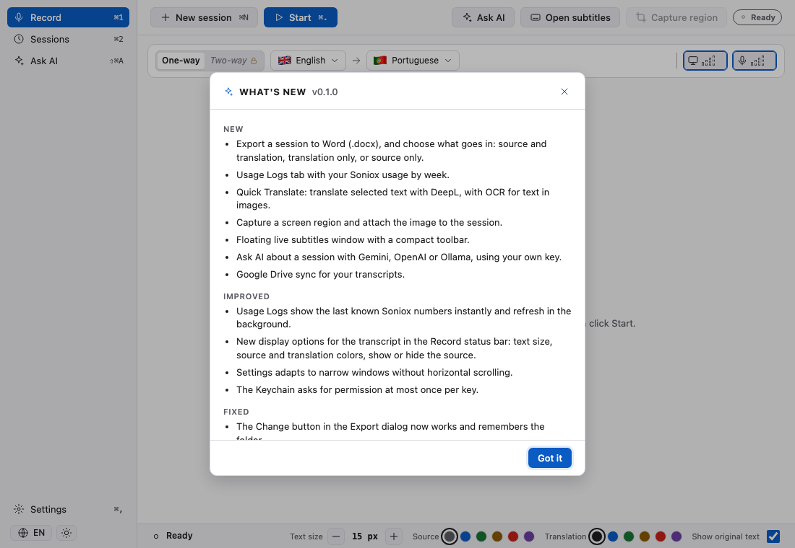
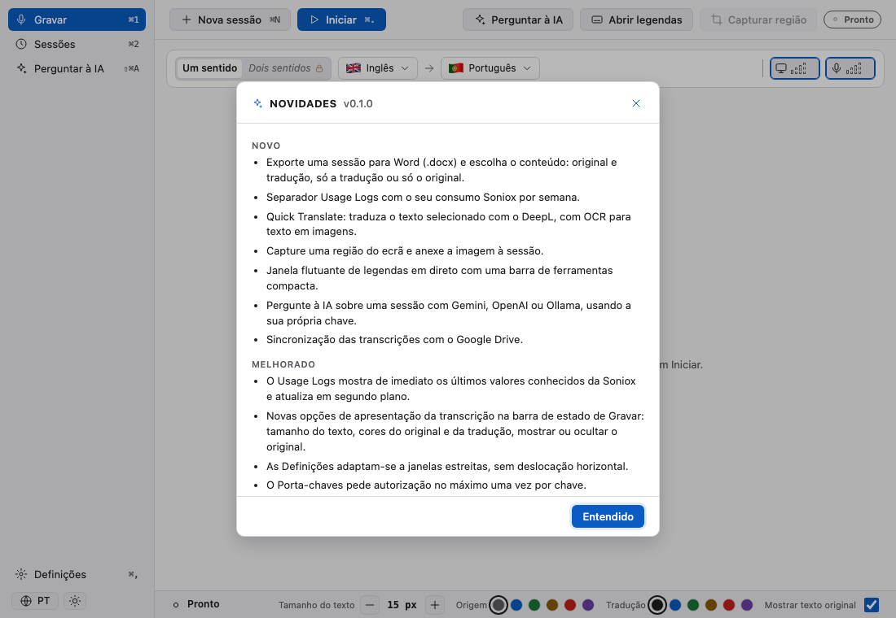
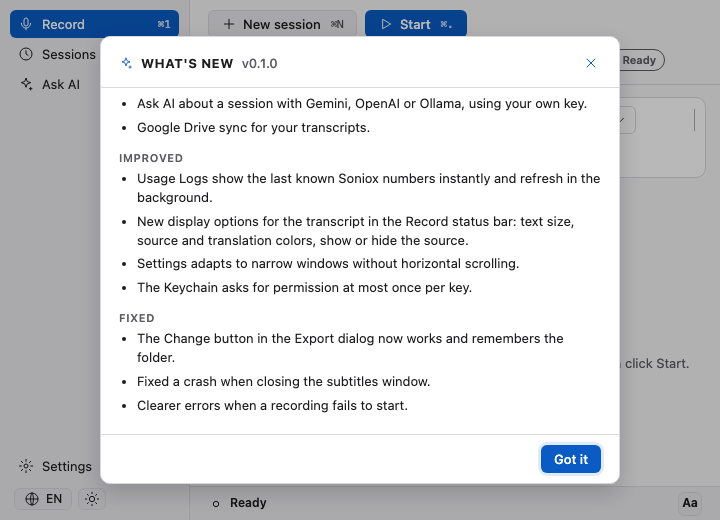
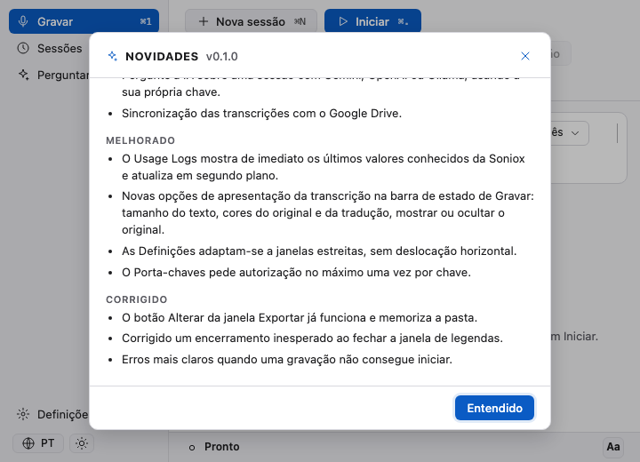

# What's New: báo cáo

Ngày 2026-11-15. Thiết kế: `docs/whats-new-thiet-ke.md`. Giao hàng gồm modal `src/lib/WhatsNew.svelte`, logic thuần `src/lib/whats-new.ts`, trạng thái `src/lib/whats-new.svelte.ts`, dữ liệu `src/changelog.json`.

## Hành vi

- Phiên bản ứng dụng: `src-tauri/tauri.conf.json` là nguồn duy nhất; `vite.config.ts` đọc nó thành hằng `__APP_VERSION__`. Test `phien ban: tauri.conf.json ... khop package.json` thất bại nếu lệch; test changelog thất bại nếu thiếu mục cho phiên bản hiện tại.
- Phiên bản đã xem: `localStorage["rlt.ui.whatsNewSeen"]`, cùng nơi lưu cài đặt giao diện (`rlt.ui.*`).
- Mở app (khung hình kế tiếp sau khi `App.svelte` mount): cài mới (chưa có khóa) chỉ ghi nhớ phiên bản; phiên bản hiện tại mới hơn bản đã xem thì hiện modal một lần, gộp các mục `bản đã xem < v <= hiện tại` theo nhóm New/Improved/Fixed; bằng nhau hoặc hạ cấp thì không hiện.
- Got it, X, Esc: đóng và ghi phiên bản hiện tại. Bấm ra ngoài không đóng.
- Mở lại thủ công: Cài đặt > About > hàng "What is new" (pt-PT: Novidades) > nút Open/Abrir.
- Móc cho US-33 (hoãn, không triển khai): hàm `onUpdateInstalled()` trong `whats-new.svelte.ts`, gọi sau khi cập nhật tự động xong và khởi động lại; hiện chưa có nơi gọi.
- Bản đầu của changelog (0.1.0) chỉ liệt kê tính năng có trong lịch sử commit: xuất Word và chọn nội dung xuất (US-56), Usage Logs, Quick Translate qua DeepL kèm OCR, chụp vùng, phụ đề nổi, Hỏi AI, đồng bộ Drive; cải tiến Usage Logs/tùy chỉnh transcript/Cài đặt responsive/Keychain; sửa nút Change của Export, crash cửa sổ phụ đề, lỗi khởi động ghi.

## Ảnh chụp

| | en | pt-PT |
|---|---|---|
| 1000x760 |  |  |
| 720x520, đã cuộn xuống cuối |  |  |

## Kết quả lệnh kiểm tra (output thật)

### cargo test --workspace
```
test result: ok. 13 passed; 0 failed; 0 ignored; 0 measured; 0 filtered out; finished in 0.01s
test result: ok. 34 passed; 0 failed; 0 ignored; 0 measured; 0 filtered out; finished in 1.15s
test result: ok. 166 passed; 0 failed; 0 ignored; 0 measured; 0 filtered out; finished in 2.89s
test result: ok. 12 passed; 0 failed; 0 ignored; 0 measured; 0 filtered out; finished in 0.00s
test result: ok. 7 passed; 0 failed; 0 ignored; 0 measured; 0 filtered out; finished in 0.59s
test result: ok. 7 passed; 0 failed; 0 ignored; 0 measured; 0 filtered out; finished in 0.00s
test result: ok. 12 passed; 0 failed; 0 ignored; 0 measured; 0 filtered out; finished in 0.15s
test result: ok. 33 passed; 0 failed; 0 ignored; 0 measured; 0 filtered out; finished in 0.26s
test result: ok. 6 passed; 0 failed; 0 ignored; 0 measured; 0 filtered out; finished in 0.06s
test result: ok. 15 passed; 0 failed; 0 ignored; 0 measured; 0 filtered out; finished in 0.16s
test result: ok. 14 passed; 0 failed; 0 ignored; 0 measured; 0 filtered out; finished in 0.28s
test result: ok. 7 passed; 0 failed; 0 ignored; 0 measured; 0 filtered out; finished in 0.09s
test result: ok. 8 passed; 0 failed; 0 ignored; 0 measured; 0 filtered out; finished in 0.82s
test result: ok. 13 passed; 0 failed; 0 ignored; 0 measured; 0 filtered out; finished in 0.01s
test result: ok. 7 passed; 0 failed; 0 ignored; 0 measured; 0 filtered out; finished in 0.06s
test result: ok. 4 passed; 0 failed; 0 ignored; 0 measured; 0 filtered out; finished in 0.03s
test result: ok. 3 passed; 0 failed; 0 ignored; 0 measured; 0 filtered out; finished in 0.01s
test result: ok. 1 passed; 0 failed; 0 ignored; 0 measured; 0 filtered out; finished in 0.00s
test result: ok. 55 passed; 0 failed; 0 ignored; 0 measured; 0 filtered out; finished in 0.03s
test result: ok. 0 passed; 0 failed; 0 ignored; 0 measured; 0 filtered out; finished in 0.00s
test result: ok. 93 passed; 0 failed; 0 ignored; 0 measured; 0 filtered out; finished in 24.57s
test result: ok. 13 passed; 0 failed; 0 ignored; 0 measured; 0 filtered out; finished in 0.07s
test result: ok. 11 passed; 0 failed; 0 ignored; 0 measured; 0 filtered out; finished in 0.00s
test result: ok. 158 passed; 0 failed; 0 ignored; 0 measured; 0 filtered out; finished in 1.71s
test result: ok. 8 passed; 0 failed; 0 ignored; 0 measured; 0 filtered out; finished in 0.00s
test result: ok. 7 passed; 0 failed; 0 ignored; 0 measured; 0 filtered out; finished in 0.31s
test result: ok. 0 passed; 0 failed; 0 ignored; 0 measured; 0 filtered out; finished in 0.00s
test result: ok. 17 passed; 0 failed; 0 ignored; 0 measured; 0 filtered out; finished in 0.17s
test result: ok. 0 passed; 0 failed; 0 ignored; 0 measured; 0 filtered out; finished in 0.00s
test result: ok. 0 passed; 0 failed; 0 ignored; 0 measured; 0 filtered out; finished in 0.00s
test result: ok. 0 passed; 0 failed; 0 ignored; 0 measured; 0 filtered out; finished in 0.00s
test result: ok. 0 passed; 0 failed; 0 ignored; 0 measured; 0 filtered out; finished in 0.00s
test result: ok. 0 passed; 0 failed; 0 ignored; 0 measured; 0 filtered out; finished in 0.00s
test result: ok. 0 passed; 0 failed; 0 ignored; 0 measured; 0 filtered out; finished in 0.00s
test result: ok. 0 passed; 0 failed; 0 ignored; 0 measured; 0 filtered out; finished in 0.00s
test result: ok. 0 passed; 0 failed; 0 ignored; 0 measured; 0 filtered out; finished in 0.00s
test result: ok. 0 passed; 0 failed; 0 ignored; 0 measured; 0 filtered out; finished in 0.00s
(tổng passed=724 failed=0, exit 0)
```
### cargo clippy --workspace --all-targets -- -D warnings
```
    Checking rlt-app v0.1.0 (/Volumes/Node/JavisOS/brains/Recorder-live-translate/projects/recorder-live-translate-v3/src-tauri)
    Finished `dev` profile [unoptimized + debuginfo] target(s) in 1.00s
(exit 0)
```
### npm run build
```
dist/assets/main-qV_yDNS9.js       114.34 kB │ gzip: 34.80 kB
dist/assets/core-ssxe-tIE.js       179.15 kB │ gzip: 59.33 kB

✓ built in 265ms
```
### npm run test:i18n
```
✔ dinh dang so va tien khac nhau dung theo locale (0.4495ms)
✔ script quet chuoi cung bat duoc chuoi cung va cho qua ma dung i18n (169.356125ms)
ℹ tests 12
ℹ suites 0
ℹ pass 12
ℹ fail 0
ℹ cancelled 0
ℹ skipped 0
ℹ todo 0
ℹ duration_ms 334.441458
```
### npm run scan:i18n
```

Quet 60 tep trong src/ (bo qua locales, i18n)
So chuoi cung tim thay: 0
```
### npm run test:unit (gồm src/lib/whats-new.test.ts)
```
> node --test src/lib/transcript-prefs.test.ts src/lib/live.test.ts src/lib/export-dir.test.ts src/lib/ci-config.test.ts src/lib/usage-swr.test.ts src/lib/whats-new.test.ts
✔ parseVersion: x.y.z, tien to v, hau to, thieu phan, sai dinh dang (0.727166ms)
✔ compareVersions so theo so, khong theo chuoi (0.10.0 > 0.9.0) (0.100917ms)
✔ mergeNotes gop cac muc moi hon ban da xem, toi ban hien tai, ban moi truoc, theo nhom (0.131583ms)
✔ mergeNotes bo ban chua ra (> hien tai) va ban da xem; chon ngon ngu (0.542834ms)
✔ decide: cai moi (chua co ban da xem) khong hien, chi ghi nho ban hien tai (0.075708ms)
✔ decide: doi phien ban thi hien, nhay nhieu ban thi gop (0.064167ms)
✔ decide: cung ban, ha cap hoac ban hien tai khong hop le thi khong hien va khong ghi (0.050208ms)
✔ decide: ban moi nhung changelog khong co muc nao thi khong hien, chi ghi nho (0.048083ms)
✔ manualNotes: ban hien tai; khong co thi ban gan nhat truoc do; khong co gi thi rong (0.108334ms)
✔ loadSeen/saveSeen: luu ben, bo gia tri hong, khong nem loi khi storage hong (0.155ms)
✔ phien ban: tauri.conf.json (nguon duy nhat) khop package.json (0.131125ms)
✔ changelog that: ban moi nhat khop phien ban ung dung, du en va pt-PT, khong tieng Viet (0.198792ms)
ℹ tests 53
ℹ pass 53
ℹ fail 0
```
### npx playwright test (toàn bộ)
```
  ✓  161 [chromium] › test/e2e/whats-new.spec.ts:15:3 › doi phien ban: hien mot lan, Got it dong va ghi nho, mo lai khong hien en 
  ✓  162 [chromium] › test/e2e/whats-new.spec.ts:15:3 › doi phien ban: hien mot lan, Got it dong va ghi nho, mo lai khong hien pt-PT 
  ✓  163 [chromium] › test/e2e/whats-new.spec.ts:36:1 › nut X dong va ghi phien ban da xem 
  ✓  164 [chromium] › test/e2e/whats-new.spec.ts:43:1 › Esc dong va ghi phien ban da xem 
  ✓  165 [chromium] › test/e2e/whats-new.spec.ts:51:1 › bam ra ngoai khong dong; Tab xoay vong trong hop thoai 
  ✓  166 [chromium] › test/e2e/whats-new.spec.ts:61:1 › cai moi (chua co phien ban da xem): khong hien, chi ghi nho phien ban 
  ✓  167 [chromium] › test/e2e/whats-new.spec.ts:67:1 › cung phien ban da xem: khong hien 
  ✓  168 [chromium] › test/e2e/whats-new.spec.ts:73:3 › mo lai thu cong tu Cai dat > About en 
  ✓  169 [chromium] › test/e2e/whats-new.spec.ts:73:3 › mo lai thu cong tu Cai dat > About pt-PT 
  ✓  170 [chromium] › test/e2e/whats-new.spec.ts:87:3 › cua so nho 720x520: noi dung cuon, Got it va X khong bi cat en 
  ✓  171 [chromium] › test/e2e/whats-new.spec.ts:87:3 › cua so nho 720x520: noi dung cuon, Got it va X khong bi cat pt-PT 

  171 passed (18.1s)
```
